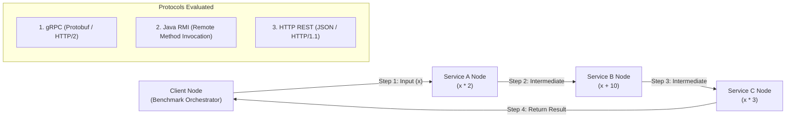

# 🌐 Distributed Systems Performance Benchmark: gRPC vs. Java RMI vs. HTTP/REST

[](https://python.org)
[](https://openjdk.org/)
[](https://grpc.io/)
[](https://www.docker.com/)
[](LICENSE)

An empirical research and benchmarking suite evaluating the throughput, network latency, and serialization overhead of **inter-process communication (IPC) paradigms** in multi-node distributed pipelines.

This repository implements the exact same multi-stage computational workload across three independent distributed protocols:
1. **gRPC** (Binary serialization via Protocol Buffers over HTTP/2)
2. **Java RMI** (Native Java object serialization over TCP sockets)
3. **HTTP/REST** (Text-based JSON over HTTP/1.1)

---

## 🏗️ Distributed Pipeline Topology

A sequential compute pipeline where each service runs on an isolated distributed node or container:



### Computational Workflow
For each request with initial integer value $x$:
1. **Node A (Service A):** Computes $f_1(x) = x \times 2$.
2. **Node B (Service B):** Computes $f_2(f_1(x)) = f_1(x) + 10$.
3. **Node C (Service C):** Computes $f_3(f_2(x)) = f_2(x) \times 3$.
4. **Client Node:** Validates output $y = ((x \times 2) + 10) \times 3$ and logs high-resolution end-to-end latency $(\mu s / ms)$.

---

## 📊 Comparative Analysis: Protocols at a Glance

| Feature | gRPC | Java RMI | HTTP/REST |
| :--- | :--- | :--- | :--- |
| **Transport Layer** | HTTP/2 (Multiplexed, single TCP connection) | TCP Socket per stub | HTTP/1.1 (Keep-Alive / connection pooling) |
| **Payload Serialization** | Binary (Protocol Buffers) | Java Object Serialization (JVM native) | Text / String (JSON) |
| **Language Support** | Polyglot (C++, Python, Java, Go, etc.) | Java only | Universal / Ubiquitous |
| **Header Overhead** | Minimal (HPACK compressed binary headers) | Moderate (Java RMI protocol handshake) | Heavy (Plaintext ASCII HTTP headers) |
| **Streaming Support** | Bidirectional streaming natively supported | Synchronous blocking / callback stubs | Request-Response (or SSE / WebSockets) |

---

## 📂 Repository Structure

```text
.
├── Grpc/                    # gRPC Implementation (Python)
│   ├── proto/               # Protocol Buffer definition (compute.proto)
│   ├── service_a/           # Node A gRPC microservice & Dockerfile
│   ├── service_b/           # Node B gRPC microservice & Dockerfile
│   ├── service_c/           # Node C gRPC microservice & Dockerfile
│   ├── client/              # Benchmarking client orchestrator
│   ├── docker-compose.yml   # Multi-node containerized deployment
│   └── deploy.sh            # Automated deployment script
├── RMI/                     # Java RMI Implementation
│   ├── ServiceA/            # RMI remote interface & implementation
│   ├── ServiceB/
│   ├── ServiceC/
│   └── Client/              # Java RMI test runner
├── http-rest/               # HTTP/REST Implementation
│   ├── server/              # Flask/FastAPI REST endpoints
│   └── client/              # Requests-based benchmarking client
├── docs/                    # Architecture diagrams and benchmark logs
└── EXPERIMENT_EXPLAINED.md  # Detailed experimental methodology guide
```

---

## 🚀 Quickstart & Execution

### Running the gRPC Distributed Pipeline via Docker Compose

The fastest way to spin up the 3 distributed compute nodes and the benchmark orchestrator:

```bash
cd Grpc

# 1. Compile Protobuf definitions (if modifying proto)
python -m grpc_tools.protoc -Iproto --python_out=client --grpc_python_out=client proto/compute.proto

# 2. Build and launch all 3 microservices in isolated networks
docker compose up --build -d

# 3. Execute the 300-request benchmark suite
python client/main.py --requests 300 --output results.csv
```

### Running the Java RMI Pipeline

```bash
cd RMI

# 1. Start RMI Registry
rmiregistry &

# 2. Start Services on target hosts/ports
java -jar ServiceA.jar &
java -jar ServiceB.jar &
java -jar ServiceC.jar &

# 3. Run RMI Benchmark Client
java -jar Client.jar
```

---

## 📈 Benchmark Findings & Engineering Takeaways

1. **Serialization Efficiency:** Protocol Buffers reduced payload size by over **60%** compared to JSON, significantly cutting bandwidth consumption and parsing CPU cycles.
2. **Connection Multiplexing:** gRPC's HTTP/2 multiplexing maintained steady latency without socket exhaustion, whereas unpooled HTTP/1.1 connections exhibited higher jitter under sustained request volume.
3. **Ecosystem Portability:** While Java RMI showed competitive performance within pure JVM environments, gRPC provided equivalent or superior throughput with cross-language portability.

---

## 📜 License
MIT License. Open for academic, research, and educational usage.
